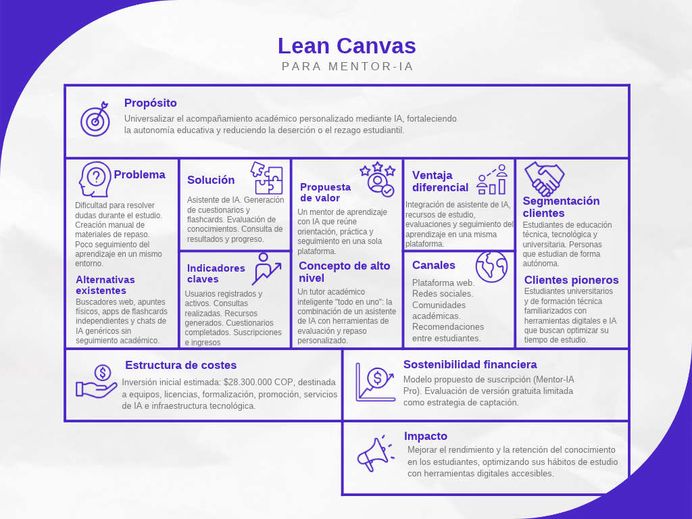

# Lean Canvas - Mentor-IA

El Lean Canvas de Mentor-IA presenta el modelo de negocio propuesto para una plataforma web que integra inteligencia artificial y herramientas de apoyo al aprendizaje. Su propósito es identificar las necesidades de los usuarios, la solución ofrecida, los medios para llegar al público objetivo y los elementos necesarios para garantizar la sostenibilidad del proyecto.

## 1. Problema

Durante los procesos de aprendizaje, los estudiantes pueden enfrentarse a diferentes dificultades:

- Resolver dudas académicas y obtener orientación mientras estudian.
- Elaborar materiales de repaso, como tarjetas de estudio y cuestionarios.
- Evaluar sus conocimientos y consultar sus resultados.
- Llevar un seguimiento de sus actividades de aprendizaje utilizando diferentes herramientas.

Actualmente, estas actividades pueden realizarse mediante búsquedas en internet, materiales educativos, aplicaciones independientes o asistentes de inteligencia artificial de propósito general. Esto puede llevar a que el estudiante utilice diferentes herramientas para complementar su proceso de estudio.

## 2. Segmentos de clientes

Mentor-IA está orientado principalmente a personas que buscan fortalecer sus procesos de aprendizaje mediante herramientas digitales.

Los segmentos de clientes propuestos son:

- **Estudiantes de educación técnica y tecnológica:** personas que necesitan reforzar conocimientos y practicar los temas abordados durante su formación.
- **Estudiantes universitarios:** usuarios que requieren apoyo para estudiar, resolver dudas y evaluar sus conocimientos.
- **Personas que desarrollan aprendizaje autónomo:** usuarios que organizan sus propios procesos de estudio y buscan herramientas para complementar su aprendizaje.

Como primeros usuarios potenciales se consideran estudiantes familiarizados con plataformas digitales y herramientas de inteligencia artificial.

## 3. Propuesta de valor única

Mentor-IA ofrece un entorno de aprendizaje que integra un asistente de inteligencia artificial con herramientas para practicar y hacer seguimiento de los conocimientos adquiridos.

Su propuesta de valor consiste en reunir orientación académica, generación de recursos de estudio, cuestionarios y consulta del progreso en una misma plataforma, facilitando el acceso a diferentes herramientas de apoyo durante el aprendizaje.

## 4. Solución

La solución consiste en una plataforma web con funcionalidades orientadas al acompañamiento del aprendizaje:

- **Asistente de inteligencia artificial:** permite realizar consultas y recibir respuestas orientadas al contexto educativo.
- **Generación de recursos de aprendizaje:** permite obtener cuestionarios y tarjetas de estudio relacionados con los temas trabajados.
- **Cuestionarios:** permite responder preguntas, procesar las respuestas y consultar los resultados obtenidos.
- **Flashcards:** ofrece recursos para repasar conceptos y contenidos.
- **Seguimiento del aprendizaje:** permite consultar información relacionada con los temas y resultados del usuario.
- **Gestión de usuarios:** permite registrar cuentas, iniciar y cerrar sesión, consultar y actualizar el perfil y mantener asociada la información a cada usuario.

## 5. Canales

Para llegar a los usuarios potenciales y dar a conocer Mentor-IA se proponen los siguientes canales:

- **Plataforma web:** será el medio principal para acceder a las funcionalidades del servicio.
- **Redes sociales:** permitirán compartir información sobre la plataforma, sus funcionalidades y sus beneficios.
- **Comunidades académicas:** espacios educativos y grupos de estudiantes donde se pueda dar a conocer la herramienta.
- **Recomendaciones de usuarios:** difusión mediante experiencias y recomendaciones de personas que utilicen la plataforma.

## 6. Fuentes de ingresos

Se propone un modelo de monetización basado en una suscripción a **Mentor-IA Pro**, dirigida a usuarios que deseen acceder a una oferta comercial de la plataforma.

Como estrategia de captación, también se contempla evaluar una modalidad gratuita con funcionalidades o capacidades limitadas, que permita a los usuarios conocer el servicio antes de adquirir una suscripción.

La tarifa, periodicidad de pago y características específicas de cada modalidad deberán definirse de acuerdo con el análisis financiero y los costos de operación.

## 7. Estructura de costos

La operación y sostenibilidad de Mentor-IA contempla diferentes categorías de costos:

- **Infraestructura tecnológica:** alojamiento de la aplicación, servicios de despliegue y dominio.
- **Servicios de inteligencia artificial:** consumo de la API utilizada para procesar las consultas de los usuarios.
- **Mantenimiento y evolución:** actividades de corrección, actualización y mejora de la plataforma.
- **Comercialización y promoción:** actividades de comunicación, posicionamiento y adquisición de usuarios.
- **Formalización y administración:** posibles gastos asociados a la constitución y gestión de la iniciativa empresarial.

Estos conceptos deben relacionarse con el presupuesto de inversión y las proyecciones financieras, diferenciando los recursos iniciales de los costos recurrentes de operación.

## 8. Métricas clave

Para evaluar el funcionamiento y la evolución del modelo de negocio se proponen indicadores relacionados con la utilización de la plataforma, la participación de los usuarios y la sostenibilidad económica:

- **Adquisición:** número de usuarios registrados.
- **Actividad:** cantidad de usuarios activos durante un periodo determinado.
- **Uso del asistente:** número de consultas realizadas a la inteligencia artificial.
- **Generación de recursos:** cantidad de cuestionarios y tarjetas de estudio generados.
- **Participación en evaluaciones:** número de cuestionarios completados.
- **Retención:** porcentaje de usuarios que regresan a utilizar la plataforma.
- **Conversión:** cantidad de usuarios que adquieren una suscripción a Mentor-IA Pro.
- **Sostenibilidad económica:** ingresos generados y relación entre ingresos y costos operativos.

Estos indicadores permitirán establecer mecanismos de seguimiento y evaluar el comportamiento del servicio a medida que se incorporen usuarios.

## 9. Ventaja diferencial

La ventaja diferencial propuesta de Mentor-IA se encuentra en la integración de distintas herramientas de apoyo al aprendizaje dentro de una misma plataforma.

A diferencia de utilizar herramientas separadas para consultar información, elaborar materiales de estudio y evaluar conocimientos, Mentor-IA reúne un asistente de inteligencia artificial, generación de recursos, cuestionarios, resultados y seguimiento del aprendizaje en un mismo entorno.

Esta integración busca ofrecer una experiencia de estudio más organizada y centralizada, con información y recursos asociados a cada usuario.

La diferenciación deberá fortalecerse mediante la evaluación de la experiencia de los usuarios y la comparación con otras soluciones disponibles en el mercado.