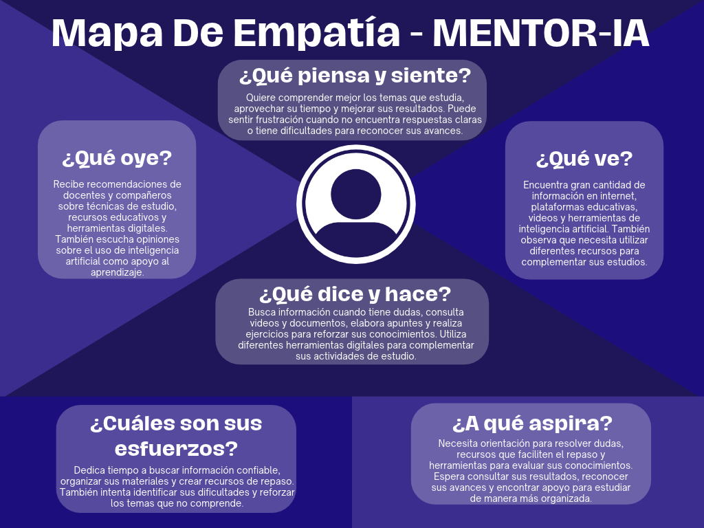

# Mapa de Empatía - Mentor-IA

## Usuario objetivo

Estudiantes de educación técnica, tecnológica y universitaria, así como personas que desarrollan procesos de aprendizaje autónomo y utilizan herramientas digitales para reforzar sus conocimientos.

### ¿Qué piensa y siente?

- Quiere comprender mejor los temas que estudia.
- Busca aprovechar su tiempo y mejorar sus hábitos de estudio.
- Puede sentir frustración cuando no encuentra respuestas claras a sus dudas.
- Desea reconocer sus avances y saber qué temas necesita reforzar.

### ¿Qué ve?

- Gran cantidad de información y recursos educativos disponibles en internet.
- Diferentes plataformas y aplicaciones para estudiar.
- Herramientas de inteligencia artificial que ofrecen respuestas y explicaciones.
- Materiales de estudio que debe consultar en distintos lugares.

### ¿Qué escucha?

- Recomendaciones de docentes y compañeros sobre herramientas de estudio.
- Consejos para mejorar sus hábitos y técnicas de aprendizaje.
- Opiniones sobre el uso de inteligencia artificial en la educación.
- Experiencias de otras personas que utilizan recursos digitales para estudiar.

### ¿Qué dice y hace?

- Busca información cuando tiene dudas sobre un tema.
- Utiliza videos, documentos y plataformas digitales para aprender.
- Elabora apuntes y materiales para repasar.
- Realiza ejercicios y cuestionarios para comprobar sus conocimientos.
- Busca alternativas que le permitan estudiar de manera más organizada.

### ¿Cuáles son sus esfuerzos?

- Dedicar tiempo a buscar información confiable y comprenderla.
- Organizar materiales de estudio provenientes de diferentes fuentes.
- Crear cuestionarios y tarjetas de repaso manualmente.
- Identificar sus dificultades y reconocer qué temas necesita reforzar.
- Mantener la constancia durante su proceso de aprendizaje.

### ¿Cuáles son sus resultados esperados?

- Obtener orientación y respuestas a sus dudas académicas.
- Contar con recursos de estudio que faciliten el repaso.
- Practicar mediante cuestionarios y evaluar sus conocimientos.
- Consultar sus resultados y avances de aprendizaje.
- Encontrar diferentes herramientas de apoyo en una misma plataforma.
- Tener una experiencia de aprendizaje accesible y organizada.

## Conclusiones

El usuario objetivo necesita herramientas que faciliten la comprensión, práctica y seguimiento de sus procesos de aprendizaje. Aunque existen diferentes recursos digitales para estudiar, utilizarlos de manera separada puede dificultar la organización de las actividades.

A partir de estas necesidades, Mentor-IA propone integrar un asistente de inteligencia artificial, generación de recursos educativos, cuestionarios y seguimiento del aprendizaje en una misma plataforma. De esta manera, busca ofrecer un entorno de apoyo que facilite el estudio autónomo y permita al usuario consultar sus actividades y resultados.