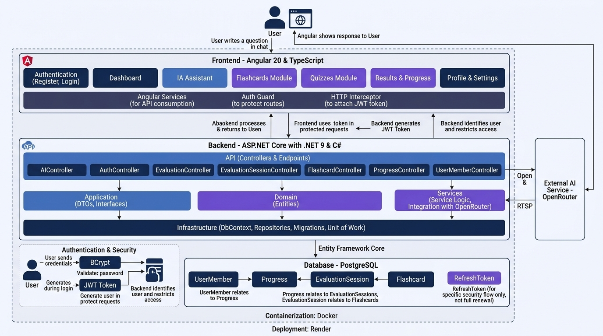

# Arquitectura del sistema – Mentor-IA

## 1. Introducción

Este documento describe la forma en que está organizado internamente Mentor-IA, teniendo en cuenta la estructura real del proyecto y la manera en que se relacionan sus diferentes componentes. La arquitectura se divide principalmente entre el frontend, encargado de la interfaz con la que interactúa el usuario, y el backend, encargado de procesar las solicitudes, manejar la información y comunicarse con los servicios externos utilizados por la aplicación.

La organización del proyecto busca mantener separadas las diferentes responsabilidades. En el frontend se encuentran las funcionalidades y componentes de la interfaz, mientras que en el backend se separan las entidades, los objetos utilizados para intercambiar información, el acceso a los datos y la API que recibe las solicitudes.

La descripción de esta arquitectura se basa en la estructura de carpetas del proyecto, los archivos desarrollados y el funcionamiento implementado actualmente en Mentor-IA.

---

## 2. Visión general del sistema

Mentor-IA es una plataforma educativa que utiliza inteligencia artificial como apoyo al aprendizaje. La aplicación está compuesta por un frontend desarrollado con Angular 20 y un backend desarrollado con ASP.NET Core sobre .NET 9 utilizando C#.

El frontend es la parte con la que interactúa directamente el usuario desde el navegador. Desde allí puede registrarse, iniciar sesión, acceder al dashboard, utilizar el chat con inteligencia artificial, trabajar con flashcards, responder cuestionarios, consultar sus resultados y revisar la información relacionada con su progreso.

El backend funciona como una API y se encarga de recibir las solicitudes realizadas desde el frontend. Dependiendo de la operación, puede consultar o guardar información en PostgreSQL mediante Entity Framework Core, realizar operaciones relacionadas con la autenticación o comunicarse con OpenRouter para obtener las respuestas de inteligencia artificial.

La comunicación con OpenRouter se realiza únicamente desde el backend. El frontend envía la solicitud a la API de Mentor-IA y es el backend el que construye y envía la petición al servicio de inteligencia artificial. Después de procesarla, la respuesta se devuelve al frontend para que pueda ser presentada dentro de la aplicación.

La autenticación utiliza JWT. La información de configuración relacionada con estos tokens se encuentra en el backend y el frontend utiliza un interceptor para incluir el token en las solicitudes que corresponda.

La aplicación se encuentra desplegada en Render y el backend cuenta además con archivos de configuración para Docker.



---

# 3. Arquitectura del frontend

El frontend de Mentor-IA fue desarrollado utilizando Angular 20. Su código principal se encuentra dentro de `src/app` y está organizado principalmente en las carpetas `core`, `features` y `shared`.

Esta separación permite diferenciar los elementos generales de la aplicación, las funcionalidades principales y los componentes que pueden reutilizarse en diferentes pantallas.

La estructura general del frontend es la siguiente:

```text
src/app/
├── app.config.ts
├── app.routes.ts
├── core/
│   ├── guards/
│   ├── interceptors/
│   │   └── auth.interceptor.ts
│   ├── models/
│   │   ├── chat-message.ts
│   │   ├── chat-request.ts
│   │   ├── chat-response.ts
│   │   └── navigation-item.ts
│   └── services/
│       ├── chat.service.ts
│       ├── dashboard.service.ts
│       ├── flashcard-state.service.ts
│       ├── layout.service.ts
│       └── quiz-state.service.ts
├── features/
│   ├── auth/
│   ├── chat/
│   ├── dashboard/
│   ├── flashcards/
│   ├── profile/
│   ├── quiz/
│   └── settings/
├── shared/
│   ├── directives/
│   ├── layout/
│   ├── pipes/
│   ├── ui/
│   └── utils/
└── styles/
    └── variables.css
```

Además de esta estructura, el proyecto cuenta con la carpeta `src/environments`, donde se encuentran `environment.ts` y `environment.prod.ts`, utilizados para la configuración de los diferentes entornos de la aplicación.

---

## 3.1. Core

La carpeta `core` contiene elementos que tienen un uso general dentro del frontend y que no pertenecen únicamente a una funcionalidad específica.

Dentro de esta carpeta se encuentran los guards, interceptors, modelos y servicios generales.

Uno de los archivos importantes es `auth.interceptor.ts`. Este interceptor toma el token almacenado en `localStorage` y, cuando existe, lo agrega a las solicitudes realizadas al backend mediante el encabezado `Authorization` utilizando el formato `Bearer`.

En `core/models` se encuentran modelos relacionados principalmente con el chat y la navegación. Entre ellos están `chat-message.ts`, `chat-request.ts`, `chat-response.ts` y `navigation-item.ts`.

La carpeta `core/services` contiene servicios utilizados para manejar diferentes operaciones desde el frontend. Entre ellos se encuentran `chat.service.ts`, `dashboard.service.ts`, `flashcard-state.service.ts`, `layout.service.ts` y `quiz-state.service.ts`.

La separación de estos elementos permite que las funciones que son utilizadas desde diferentes partes de la aplicación no tengan que estar implementadas directamente dentro de cada página.

---

## 3.2. Features

La carpeta `features` contiene las funcionalidades principales de Mentor-IA. Cada funcionalidad tiene su propio espacio y dentro de este se organizan las páginas, modelos, servicios o componentes que necesita.

Actualmente se encuentran los módulos de autenticación, chat, dashboard, flashcards, perfil, cuestionarios y configuración.

Esta organización permite mantener relacionado el código que pertenece a una misma funcionalidad y facilita encontrar los archivos cuando es necesario realizar cambios o corregir algún comportamiento.

---

## 3.3. Autenticación

La funcionalidad de autenticación se encuentra dentro de `features/auth`.

En este módulo están las páginas de inicio de sesión y registro, además de los modelos utilizados para manejar la información de estas operaciones.

Los modelos principales son `login-request.ts`, `login-response.ts` y `register-request.ts`. También se encuentra `auth.service.ts`, que contiene las operaciones relacionadas con la autenticación desde el frontend.

El módulo cuenta además con `auth.guard.ts`, utilizado para controlar el acceso a las rutas que requieren autenticación.

La autenticación del frontend se complementa con el manejo de JWT implementado en el backend.

---

## 3.4. Chat

El módulo de chat se encuentra dentro de `features/chat` y corresponde a una de las funcionalidades principales de Mentor-IA.

Su estructura separa diferentes partes de la interfaz de la conversación. Cuenta con los componentes `chat-input`, `conversation` y `message`, además de la página `chat`.

La comunicación con el backend se realiza mediante el servicio `chat.service.ts`. Desde el frontend se envía la información correspondiente a la pregunta realizada por el usuario y posteriormente se recibe la respuesta para mostrarla dentro de la conversación.

El frontend no realiza directamente la comunicación con OpenRouter. Esta integración se encuentra en el backend, por lo que Angular únicamente se comunica con la API de Mentor-IA.

Actualmente el proyecto no cuenta con una entidad ni un mecanismo de persistencia para guardar las conversaciones completas del chat. Por esta razón, el historial de una conversación no se almacena de forma permanente en PostgreSQL.

---

## 3.5. Dashboard

El dashboard se encuentra dentro de `features/dashboard` y cuenta con la página `home`.

Esta sección funciona como una de las principales pantallas de la aplicación después de que el usuario inicia sesión y permite acceder a las diferentes funcionalidades disponibles dentro de Mentor-IA.

La información correspondiente al dashboard se maneja mediante `dashboard.service.ts`, ubicado dentro de los servicios generales del frontend.

---

## 3.6. Flashcards

La funcionalidad de flashcards se encuentra dentro de `features/flashcards`.

El módulo cuenta con modelos para representar las tarjetas y la información relacionada con sus resultados. Entre estos archivos se encuentran `flashcard.ts`, `flashcard-rating.ts` y `flashcard-result.ts`.

También cuenta con `flashcard.service.ts`, encargado de las operaciones relacionadas con esta funcionalidad.

Las flashcards hacen parte de los recursos de aprendizaje disponibles dentro de Mentor-IA y se encuentran integradas con el resto de las funcionalidades de la plataforma.

---

## 3.7. Cuestionarios y progreso

La funcionalidad de cuestionarios se encuentra dentro de `features/quiz`.

En este módulo se encuentran los elementos utilizados para manejar las preguntas, respuestas, envíos y resultados de los cuestionarios. Entre los modelos se encuentran `quiz-question.ts`, `quiz-answer.ts`, `quiz-submission.ts` y `quiz-result.ts`.

También se encuentran `progress.ts` y `progress-request.ts`, relacionados con la información de progreso que maneja esta funcionalidad.

Los servicios `quiz.service.ts` y `progress.service.ts` se encargan de realizar las operaciones necesarias desde el frontend.

---

## 3.8. Perfil y configuración

Mentor-IA también cuenta con una funcionalidad de perfil, ubicada dentro de `features/profile`. En esta carpeta se encuentra la página `profile`.

El proyecto también cuenta con `features/settings`, donde se encuentran los elementos relacionados con la configuración de la aplicación.

Estas funcionalidades se mantienen separadas de los demás módulos para conservar una organización clara dentro del frontend.

---

## 3.9. Shared

La carpeta `shared` contiene elementos que pueden reutilizarse en diferentes partes de la aplicación.

Dentro de ella se encuentran las carpetas `directives`, `layout`, `pipes`, `ui` y `utils`.

En `layout` se encuentran los elementos que forman parte de la estructura general de la aplicación, como `dashboard-layout`, `sidebar`, `topbar` y `right-panel`.

La carpeta `ui` contiene componentes visuales reutilizables como `avatar`, `badge`, `button`, `card`, `search-input` y `stat-card`.

Esta organización permite reutilizar componentes en diferentes pantallas sin tener que crear una versión independiente de cada uno para cada funcionalidad.

---

# 4. Rutas del frontend

Las rutas principales de la aplicación se encuentran definidas en `app.routes.ts`.

Las páginas de inicio de sesión y registro son accesibles mediante `/login` y `/register`, respectivamente. Estas rutas no requieren que el usuario haya iniciado sesión.

Las demás funcionalidades se encuentran dentro de `DashboardLayoutComponent` y están protegidas mediante `authGuard`.

Dentro de esta estructura se encuentran las rutas correspondientes al dashboard, chat, quiz y flashcards.

Cuando el usuario accede a la ruta principal sin especificar una sección, esta se redirige al dashboard. Las rutas que no están definidas también cuentan con una redirección hacia `/login`.

De esta manera, las funcionalidades principales quedan protegidas para que puedan ser utilizadas dentro del contexto de un usuario autenticado.

---

# 5. Arquitectura del backend

El backend de Mentor-IA está desarrollado con ASP.NET Core sobre .NET 9 utilizando C#.

Dentro de la carpeta `backend` se encuentran cuatro proyectos principales: `Apieducation`, `Application`, `Domain` e `Infrastructure`. Cada uno cuenta con su propio archivo `.csproj` y todos forman parte de la solución `education.sln`.

La estructura general es:

```text
backend/
├── Apieducation/
│   ├── Controllers/
│   ├── Extensions/
│   ├── Helpers/
│   ├── Profiles/
│   └── Services/
├── Application/
│   ├── DTOs/
│   └── Interfaces/
├── Domain/
│   └── Entities/
└── Infrastructure/
    ├── Data/
    │   ├── Configuration/
    │   └── Migrations/
    ├── Repositories/
    └── UnitOfWork/
```

La división de estos proyectos permite separar las entidades principales del sistema, los objetos utilizados por la aplicación, el acceso a los datos y la API que recibe las solicitudes.

---

# 6. Domain

El proyecto `Domain` contiene las entidades principales utilizadas por Mentor-IA.

Dentro de `Domain/Entities` se encuentran:

```text
BaseEntity.cs
EvaluationSession.cs
Flashcard.cs
Progress.cs
RefreshToken.cs
UserMember.cs
```

`UserMember` representa la información de los usuarios registrados en la plataforma. Esta entidad contiene, entre otros datos, el nombre completo, el correo y el hash de la contraseña, generado mediante BCrypt.

`Progress` representa la información de progreso relacionada con un tema de aprendizaje. En el código utilizado actualmente se maneja el identificador del usuario, el tema, el puntaje y el feedback.

`EvaluationSession` representa una sesión de evaluación y contiene información como el puntaje, el feedback y el identificador del progreso al que corresponde.

`Flashcard` representa las tarjetas de estudio y contiene la información correspondiente a la pregunta, la respuesta y la sesión de evaluación con la que está relacionada.

`RefreshToken` forma parte de las entidades utilizadas para el manejo de autenticación.

Finalmente, `BaseEntity` contiene elementos comunes utilizados por las entidades que hacen parte del dominio.

El proyecto `Domain` se mantiene separado de la implementación concreta de la API y del acceso a la base de datos, por lo que funciona como la parte central donde se encuentran las entidades del sistema.

---

# 7. Application

El proyecto `Application` contiene los DTOs y las interfaces utilizadas por el resto del backend.

Los DTOs se encuentran dentro de `Application/DTOs` y están divididos entre los relacionados con autenticación y los correspondientes a las diferentes entidades y funcionalidades.

Dentro de autenticación se encuentran `DataUserDto`, `LoginDto` y `RegisterDto`.

En `Entities` se encuentran `AnswerDto`, `EvaluationSessionDto`, `FlashcardDto`, `ProgressDto`, `QuizSubmissionDto`, `UserChatRequestDto` y `UserMemberDto`.

Estos objetos se utilizan para definir la información que se recibe o se devuelve durante las diferentes operaciones de la API, sin tener que utilizar directamente las entidades del dominio para todos los intercambios de información.

En `Application/Interfaces` se encuentran las interfaces de los repositorios y del `UnitOfWork`, entre ellas `IEvaluationSessionRepository`, `IFlashcardRepository`, `IGenericRepository`, `IProgressRepository`, `IUnitOfWork` y `IUserMemberRepository`.

---

# 8. Infrastructure

El proyecto `Infrastructure` contiene los elementos relacionados con el acceso y persistencia de los datos.

Dentro de `Data` se encuentra `PublicDBContext.cs`, que corresponde al contexto utilizado por Entity Framework Core para trabajar con PostgreSQL.

También se encuentra la carpeta `Configuration`, donde están las configuraciones de las entidades. Actualmente existen configuraciones para `EvaluationSession`, `Progress`, `UserMember` y `Flashcard`.

Dentro de `Migrations` se encuentra la migración inicial `InitialCreate`, generada para crear la estructura inicial de la base de datos.

La carpeta `Repositories` contiene las implementaciones de los repositorios utilizados por el backend, mientras que `UnitOfWork` contiene la implementación de `UnitOfWork`.

Esta separación permite que el acceso a los datos permanezca en la capa de infraestructura y no directamente dentro de todas las partes de la aplicación.

---

# 9. Repositorios y Unit of Work

Para trabajar con la información almacenada en PostgreSQL, Mentor-IA utiliza repositorios.

Existe un `GenericRepository` para operaciones generales y repositorios específicos para `EvaluationSession`, `Flashcard`, `Progress` y `UserMember`.

Las interfaces de estos repositorios se encuentran en `Application/Interfaces`, mientras que sus implementaciones están dentro de `Infrastructure/Repositories`.

También se utiliza `UnitOfWork`, cuya interfaz se encuentra en `Application/Interfaces/IUnitOfWork.cs` y cuya implementación está en `Infrastructure/UnitOfWork/UnitOfWork.cs`.

El `UnitOfWork` reúne los repositorios utilizados por la aplicación y permite guardar los cambios realizados mediante `SaveAsync`.

Por ejemplo, en la funcionalidad del chat, el controlador utiliza el `UnitOfWork` para consultar el progreso del usuario, crear un nuevo registro cuando todavía no existe el tema y guardar los cambios realizados.

---

# 10. Apieducation

`Apieducation` es el proyecto que contiene la API de Mentor-IA y es el punto mediante el cual el frontend se comunica con el backend.

Dentro de este proyecto se encuentran los controladores, servicios, helpers, extensiones y perfiles de mapeo.

En `Extensions` se encuentra `ApplicationServiceExtensions.cs`. En `Helpers` están `ApiException`, `ApiResponse`, `ApiValidation`, `JsonHelpers` y `JWT`.

También existe `MappingProfiles.cs` dentro de `Profiles`, donde se encuentran definidos los mapeos utilizados por AutoMapper.

Los servicios propios de esta parte del backend están dentro de `Services` y corresponden a `IUserService`, `UserService` y `OpenRouterService`.

---

# 11. Controladores

Los controladores son los encargados de recibir las solicitudes HTTP realizadas a la API y procesarlas de acuerdo con la funcionalidad correspondiente.

Dentro de `Apieducation/Controllers` se encuentran `AIController`, `AuthController`, `EvaluationController`, `EvaluationSessionController`, `FlashcardController`, `MCPController`, `ProgressController` y `UserMemberController`, además de `BaseApiController`.

También se cuenta con el controlador relacionado con el contexto MCP, utilizado para consultar información que puede ser requerida por este componente.

A continuación se describen los controladores de los cuales se tiene documentado el comportamiento a nivel de código.

---

## 11.1. AIController

`AIController` maneja el endpoint `POST chat`, utilizado para la funcionalidad de conversación con inteligencia artificial.

El endpoint recibe un `UserChatRequestDto`, que contiene la información necesaria para procesar la pregunta realizada por el usuario.

Antes de enviar la solicitud a OpenRouter, el controlador construye un prompt que establece el comportamiento esperado de la inteligencia artificial. Dentro de este prompt se indica que debe actuar como un mentor educativo, responder en el mismo idioma de la pregunta y entregar la respuesta utilizando un formato JSON con las propiedades `allow`, `topic` y `answer`.

También se establecen reglas para determinar qué tipo de preguntas pueden ser atendidas. Se contemplan preguntas educativas como definiciones, explicaciones y comparaciones, incluso cuando están relacionadas con temas como cine, música o videojuegos. También se definen comportamientos para saludos y para solicitudes que no corresponden al propósito educativo de la plataforma.

El prompt también establece que los cuestionarios solamente deben generarse cuando el usuario los solicite explícitamente.

Después de enviar la solicitud mediante `OpenRouterService`, el controlador intenta interpretar la respuesta obtenida como JSON.

Cuando la respuesta indica que la solicitud no está permitida, se devuelve un mensaje informando al usuario que Mentor-IA responde únicamente preguntas relacionadas con temas educativos.

Cuando la pregunta es aceptada, el controlador consulta el progreso del usuario para el tema identificado. Si todavía no existe un registro, crea uno con puntaje inicial de cero y un feedback relacionado con el inicio del tema. Si el registro ya existe, actualiza el feedback con la información correspondiente a la última interacción.

Después de guardar los cambios, la respuesta enviada al frontend incluye la información del usuario, la pregunta realizada, el tema identificado, la respuesta generada y el identificador del progreso.

Si la respuesta obtenida de la inteligencia artificial no puede interpretarse correctamente como JSON, el sistema devuelve un mensaje indicando que no fue posible procesar la petición en ese momento.

Las operaciones relacionadas con el progreso en este controlador se realizan utilizando `IUnitOfWork`.

---

## 11.2. AuthController

`AuthController` contiene los endpoints relacionados con el registro y el inicio de sesión.

El endpoint `POST register` recibe la información necesaria para registrar un usuario. Antes de realizar el registro, valida los datos y verifica que no exista otro usuario utilizando el mismo correo.

Cuando el registro es válido, se crea un `UserMember` con el nombre completo y el correo proporcionados. La contraseña no se almacena directamente, sino que se cifra utilizando BCrypt.

El endpoint `POST login` permite iniciar sesión. Para esto, busca el usuario mediante su correo y verifica la contraseña utilizando BCrypt.

Cuando las credenciales son correctas, se genera un token JWT firmado mediante HMAC SHA-256. La información relacionada con la clave, el emisor, la audiencia y la duración del token se obtiene de la configuración de la aplicación, específicamente de la sección `Jwt`.

La respuesta del inicio de sesión utiliza `DataUserDto` e incluye la información del usuario y el token generado.

A diferencia de `AIController`, `AuthController` trabaja directamente con `PublicDBContext` para las operaciones de registro e inicio de sesión.

---

## 11.3. ContextController

El controlador relacionado con el contexto cuenta con tres endpoints de consulta que permiten obtener información de recursos asociados al usuario.

El primero permite consultar el progreso de un usuario mediante su identificador. La respuesta contiene información como el identificador del progreso, el tema, el puntaje y el feedback.

El segundo permite consultar las sesiones de evaluación relacionadas con un progreso determinado.

El tercero permite consultar las flashcards asociadas a una sesión de evaluación.

Estas consultas utilizan `UnitOfWork` para acceder a la información correspondiente y devuelven las respuestas utilizando una estructura que contiene las propiedades `name`, `type` y `data`.

El valor utilizado para `type` corresponde a `resource`, de acuerdo con la implementación actual.

---

# 12. Servicios

Dentro de `Apieducation/Services` se encuentran los servicios utilizados por la API.

`UserService` contiene operaciones relacionadas con los usuarios y cuenta con la interfaz `IUserService`.

El servicio más relacionado con la funcionalidad de inteligencia artificial es `OpenRouterService`. Este servicio se encarga de enviar las solicitudes al servicio de OpenRouter mediante el método `AskAsync`.

De esta manera, el controlador de inteligencia artificial no necesita realizar directamente toda la comunicación con el servicio externo, sino que utiliza el servicio creado para esta función.

---

# 13. Persistencia de datos

Mentor-IA utiliza PostgreSQL como base de datos y Entity Framework Core para trabajar con ella desde el backend.

El contexto utilizado para la conexión y manejo de las entidades es `PublicDBContext`, ubicado en `Infrastructure/Data`.

La estructura inicial de la base de datos se encuentra representada mediante la migración `InitialCreate`, ubicada en `Infrastructure/Data/Migrations`.

Las principales entidades que participan actualmente en la persistencia son `UserMember`, `Progress`, `EvaluationSession`, `Flashcard` y `RefreshToken`.

Un registro de `Progress` está asociado a un usuario mediante `UserMemberId` y contiene información relacionada con el tema, el puntaje y el feedback.

Una `EvaluationSession` contiene su información de evaluación y el identificador del progreso correspondiente mediante `ProgressId`.

Por su parte, una `Flashcard` contiene una pregunta y una respuesta, además del identificador de la sesión de evaluación mediante `EvaluationSessionId`.

En el caso de `UserMember`, la información almacenada incluye el nombre completo, el correo y el hash de la contraseña.

Actualmente no existe una entidad destinada a almacenar las conversaciones del chat. Por esta razón, las conversaciones no se conservan como un historial permanente en PostgreSQL. Lo que sí se registra en la base de datos es el progreso asociado a los temas tratados.

---

# 14. Integración con inteligencia artificial

La inteligencia artificial de Mentor-IA se integra mediante OpenRouter.

La configuración utilizada por la API incluye la URL del servicio de chat de OpenRouter y el modelo utilizado actualmente, `poolside/laguna-s-2.1:free`.

La comunicación con OpenRouter está encapsulada en `OpenRouterService`, cuyo método `AskAsync` se utiliza desde `AIController`.

Cuando un usuario realiza una pregunta en el chat, el frontend envía la información a la API. El backend recibe la solicitud, construye el prompt con las instrucciones definidas para Mentor-IA y utiliza `OpenRouterService` para realizar la consulta.

La respuesta obtenida se procesa en el backend antes de ser enviada nuevamente al frontend.

Esta forma de integración permite que la comunicación con OpenRouter permanezca en el backend y que el frontend solamente tenga que comunicarse con la API de Mentor-IA.

---

# 15. Autenticación mediante JWT

La autenticación de Mentor-IA utiliza JSON Web Tokens (JWT).

En el backend existe el helper `JWT.cs`, ubicado dentro de `Apieducation/Helpers`, y la generación del token se realiza durante el inicio de sesión.

El token contiene información que permite identificar al usuario y se firma mediante HMAC SHA-256. La clave utilizada para firmarlo, junto con el emisor, la audiencia y la duración, se obtiene desde la configuración de la aplicación.

Una vez generado el token, el frontend lo almacena en `localStorage`.

Posteriormente, `auth.interceptor.ts` verifica si existe un token y, cuando corresponde, lo agrega a las solicitudes mediante el encabezado `Authorization` con el formato `Bearer`.

De esta manera, el mecanismo de autenticación se encuentra conectado entre el inicio de sesión del backend, el almacenamiento del token en el frontend y las solicitudes posteriores realizadas a la API.

---

# 16. Manejo de respuestas y errores

El backend cuenta con diferentes helpers destinados a organizar el manejo de respuestas, validaciones y excepciones.

Dentro de `Apieducation/Helpers` se encuentran `ApiException`, `ApiResponse`, `ApiValidation` y `JsonHelpers`.

Estos componentes hacen parte de la estructura utilizada para procesar las respuestas de la API y manejar situaciones relacionadas con validaciones y excepciones.

En el frontend también se contemplan los casos de error dentro de la experiencia de las diferentes funcionalidades, de acuerdo con el manejo implementado en la aplicación.

---

# 17. Docker

El backend incluye archivos relacionados con Docker dentro de la carpeta `backend`.

Entre ellos se encuentran `Dockerfile`, `docker-compose.yml`, `.dockerignore` y `.env.docker`.

Estos archivos permiten definir la configuración necesaria para preparar el entorno de ejecución mediante contenedores.

La utilización de Docker también hace parte de la preparación del proyecto para su ejecución y despliegue.

---

# 18. Despliegue

Mentor-IA se encuentra desplegado en Render.

El backend cuenta con la configuración necesaria para su ejecución y con los archivos relacionados con Docker utilizados durante la preparación del proyecto.

La documentación detallada del despliegue, incluyendo la configuración específica utilizada para poner la aplicación en funcionamiento, se desarrollará en la sección correspondiente a `09-despliegue`.

---

# 19. Relación entre las diferentes partes del sistema

La organización actual de Mentor-IA permite separar las responsabilidades del proyecto sin dejar aisladas sus diferentes partes.

El usuario interactúa con las pantallas desarrolladas en Angular. Cuando realiza una operación que necesita información o procesamiento del backend, los servicios correspondientes del frontend realizan una solicitud HTTP a la API.

La solicitud llega al controlador correspondiente dentro de `Apieducation`. Dependiendo de la operación, este puede trabajar con los servicios de la aplicación, consultar o modificar información mediante `UnitOfWork` y los repositorios, o utilizar `OpenRouterService` cuando se trata de una solicitud relacionada con inteligencia artificial.

Las entidades que representan la información principal se encuentran en `Domain`, mientras que los DTOs e interfaces utilizados por las diferentes capas se encuentran en `Application`. La implementación del acceso a PostgreSQL se encuentra en `Infrastructure`.

Después de realizar la operación correspondiente, el backend devuelve la información al frontend y este se encarga de presentarla dentro de la interfaz de Mentor-IA.

---

# 20. Tecnologías utilizadas

La arquitectura actual de Mentor-IA está construida con las siguientes tecnologías:

| Parte                        | Tecnología                   |
| ---------------------------- | ---------------------------- |
| Frontend                     | Angular 20                   |
| Lenguaje del frontend        | TypeScript                   |
| Backend                      | ASP.NET Core .NET 9          |
| Lenguaje del backend         | C#                           |
| Base de datos                | PostgreSQL                   |
| Acceso a datos               | Entity Framework Core        |
| Autenticación                | JWT                          |
| Cifrado de contraseñas       | BCrypt                       |
| Inteligencia artificial      | OpenRouter                   |
| Modelo utilizado actualmente | `poolside/laguna-s-2.1:free` |
| Contenedores                 | Docker                       |
| Despliegue                   | Render                       |

---

# 21. Alcance actual de la arquitectura

La arquitectura implementada actualmente permite que Mentor-IA integre en una misma plataforma el registro y acceso de usuarios, el dashboard, el chat con inteligencia artificial, las flashcards, los cuestionarios, los resultados, el seguimiento del progreso, el perfil y las funcionalidades relacionadas con la navegación y el manejo de errores.

La información relacionada con los usuarios, el progreso, las sesiones de evaluación y las flashcards se maneja mediante PostgreSQL y Entity Framework Core.

El chat utiliza OpenRouter como servicio de inteligencia artificial y permite registrar el progreso relacionado con los temas tratados. Sin embargo, las conversaciones completas no se almacenan de forma permanente, ya que actualmente no existe una entidad destinada a guardar el historial del chat.

La estructura utilizada en el frontend y en el backend permite mantener separadas las diferentes responsabilidades del sistema y facilita la ubicación de cada funcionalidad dentro del proyecto.

---

# 22. Conclusión

La arquitectura de Mentor-IA fue organizada separando el frontend, el backend y la persistencia de los datos, de manera que cada parte tenga una responsabilidad definida dentro de la aplicación.

En el frontend, la división entre `core`, `features` y `shared` permite organizar las funcionalidades y reutilizar los componentes que se necesitan en diferentes pantallas. En el backend, la separación entre `Domain`, `Application`, `Infrastructure` y `Apieducation` permite diferenciar las entidades, los objetos utilizados por la aplicación, el acceso a los datos y los controladores que reciben las solicitudes.

La comunicación entre estas partes permite que las funcionalidades desarrolladas para Mentor-IA funcionen dentro de una misma plataforma. Además, la integración de PostgreSQL mediante Entity Framework Core, JWT para la autenticación y OpenRouter para la inteligencia artificial complementa la estructura necesaria para el funcionamiento actual del proyecto.