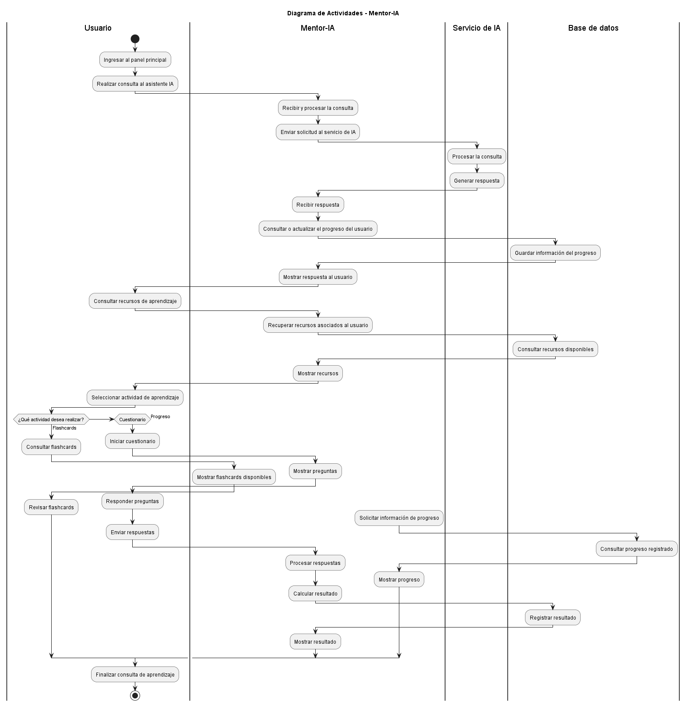

# Diagrama de Actividades - Mentor-IA

## Proceso
El proceso corresponde a la gestión del aprendizaje del usuario dentro de la plataforma Mentor-IA. Inicia cuando el usuario autenticado accede al panel principal y realiza una consulta al asistente de inteligencia artificial para resolver dudas relacionadas con sus temas de estudio. La solicitud es recibida por el backend, que se encarga de procesarla y comunicarse con el servicio de inteligencia artificial para obtener una respuesta.

A partir de esta interacción, el usuario puede continuar con las actividades de aprendizaje disponibles en la plataforma, como consultar flashcards, desarrollar cuestionarios y revisar los resultados de sus evaluaciones. Estas operaciones involucran la consulta y el almacenamiento de información en la base de datos, manteniendo su asociación con el usuario autenticado.

### Descripción
El diagrama de actividades representa el flujo principal del proceso de aprendizaje en Mentor-IA, desde la interacción del usuario con el asistente de inteligencia artificial hasta la consulta de recursos educativos, la realización de evaluaciones y la revisión del progreso.

Durante estas actividades, la plataforma gestiona las diferentes alternativas de interacción según la opción seleccionada por el usuario. Asimismo, consulta y almacena la información correspondiente en la base de datos, permitiendo visualizar los resultados y el progreso de aprendizaje registrado.

### Diagrama

