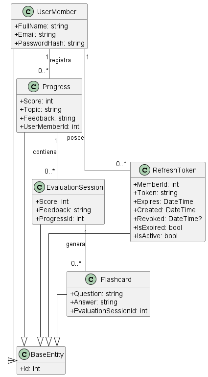

# Diagrama de Clases - Mentor-IA

## Descripción

El diagrama de clases representa la estructura estática de Mentor-IA, identificando las principales clases que intervienen en la gestión de usuarios, el seguimiento del progreso de aprendizaje, las evaluaciones y los recursos educativos.

La estructura se basa en las entidades del dominio definidas en el backend, las cuales representan la información persistente del sistema y las relaciones establecidas entre los usuarios y sus actividades de aprendizaje. Estas entidades heredan de una clase base que proporciona un identificador común.

## Clases principales

### BaseEntity

**Atributos:**
- Identificador único (`Id`).

**Responsabilidades:**

Proporcionar un identificador común a las entidades principales del dominio: UserMember, Progress, EvaluationSession, Flashcard y RefreshToken.

### UserMember

**Atributos:**
- Identificador del usuario (`Id`).
- Nombre completo (`FullName`).
- Correo electrónico (`Email`).
- Hash de la contraseña (`PasswordHash`).

**Responsabilidades:**

Representar a los usuarios registrados en Mentor-IA, almacenar su información de cuenta y mantener las relaciones con los registros de progreso y los tokens de actualización asociados.

### Progress

**Atributos:**
- Identificador del progreso (`Id`).
- Identificador del usuario (`UserMemberId`).
- Tema de estudio (`Topic`).
- Puntuación (`Score`).
- Retroalimentación (`Feedback`).

**Responsabilidades:**

Almacenar la información relacionada con el progreso de aprendizaje del usuario, incluyendo los temas trabajados, las puntuaciones y la retroalimentación registrada. También mantiene la relación con las sesiones de evaluación correspondientes.

### EvaluationSession

**Atributos:**
- Identificador de la sesión de evaluación (`Id`).
- Puntuación (`Score`).
- Retroalimentación (`Feedback`).
- Identificador del progreso asociado (`ProgressId`).

**Responsabilidades:**

Representar las sesiones de evaluación asociadas a un registro de progreso, conservando la información correspondiente a los resultados obtenidos y las flashcards relacionadas.

### Flashcard

**Atributos:**
- Identificador de la flashcard (`Id`).
- Pregunta (`Question`).
- Respuesta (`Answer`).
- Identificador de la sesión de evaluación asociada (`EvaluationSessionId`).

**Responsabilidades:**

Representar los recursos de aprendizaje tipo flashcard, almacenando las preguntas y respuestas asociadas a una sesión de evaluación.

### RefreshToken

**Atributos:**
- Identificador del token (`Id`).
- Identificador del usuario asociado (`MemberId`).
- Valor del token (`Token`).
- Fecha de expiración (`Expires`).
- Fecha de creación (`Created`).
- Fecha de revocación (`Revoked`).

**Propiedades calculadas:**
- `IsExpired`: indica si el token ha superado su fecha de expiración.
- `IsActive`: indica si el token no ha sido revocado y continúa vigente.

**Responsabilidades:**

Representar los tokens de actualización asociados a los usuarios, incluyendo su vigencia, fecha de creación y estado de revocación.

## Relaciones

Las principales relaciones entre las entidades son:

- **UserMember – Progress:** un usuario puede tener varios registros de progreso, y cada registro de progreso pertenece a un usuario.
- **Progress – EvaluationSession:** un registro de progreso puede estar asociado a varias sesiones de evaluación, y cada sesión pertenece a un registro de progreso.
- **EvaluationSession – Flashcard:** una sesión de evaluación puede estar asociada a varias flashcards, y cada flashcard pertenece a una sesión de evaluación.
- **UserMember – RefreshToken:** un usuario puede tener varios tokens de actualización asociados, y cada token pertenece a un usuario.
- **Herencia de BaseEntity:** las entidades UserMember, Progress, EvaluationSession, Flashcard y RefreshToken heredan de BaseEntity, compartiendo el atributo identificador.

Estas relaciones permiten mantener organizada la información de aprendizaje y conservar su asociación con el usuario correspondiente.

## Diagrama

