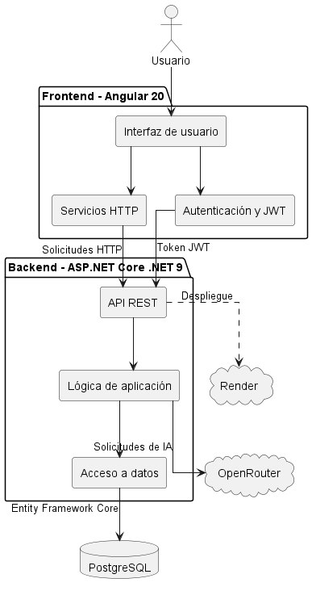

# Diagrama de Componentes - Mentor-IA

## Componentes

### Frontend

Corresponde a la interfaz de usuario desarrollada con Angular 20. Permite acceder a las funcionalidades de la plataforma mediante módulos organizados por características:

- **Autenticación:** registro e inicio de sesión.
- **Dashboard:** visualización del panel principal y navegación.
- **Chat:** interacción con el asistente de inteligencia artificial.
- **Flashcards:** consulta de recursos de aprendizaje.
- **Quiz:** realización de cuestionarios y consulta de resultados.
- **Profile:** consulta y actualización de la información del usuario.
- **Settings:** acceso a las opciones de configuración.

El frontend se comunica con el backend mediante solicitudes HTTP. También utiliza un interceptor para adjuntar el token de autenticación cuando corresponde y servicios para gestionar las operaciones y el estado de las funcionalidades.

### Backend

Desarrollado con ASP.NET Core sobre .NET 9, constituye la capa encargada de procesar las solicitudes del frontend, gestionar la lógica de la aplicación y establecer la comunicación con la base de datos y los servicios externos.

Se organiza en las siguientes capas:

- **API REST:** contiene los controladores encargados de recibir las solicitudes HTTP y coordinar las operaciones de la aplicación.
- **Application:** contiene los DTO, interfaces y servicios que intervienen en la ejecución de las funcionalidades.
- **Domain:** contiene las entidades principales que representan la información del sistema.
- **Infrastructure:** gestiona el acceso a los datos mediante Entity Framework Core, repositorios, Unit of Work y el contexto de base de datos.

### Base de datos

Corresponde a PostgreSQL, utilizado para almacenar la información persistente de Mentor-IA. El acceso se realiza desde el backend mediante Entity Framework Core y la clase `PublicDbContext`.

Almacena información relacionada con los usuarios, el progreso de aprendizaje, las sesiones de evaluación y las flashcards.

### Servicio de IA

Corresponde a OpenRouter, servicio externo que permite integrar modelos de inteligencia artificial con Mentor-IA.

La comunicación se realiza exclusivamente desde el backend mediante `OpenRouterService`, que envía las solicitudes al servicio y recibe las respuestas para su procesamiento. Se utiliza en la interacción con el asistente y en la generación de cuestionarios.

### Servicios y tecnologías de soporte

La plataforma utiliza servicios y tecnologías complementarias para su ejecución y despliegue:

- **Render:** plataforma utilizada para el despliegue de la aplicación.
- **Docker:** tecnología utilizada para preparar el entorno de ejecución del backend mediante contenedores.

## Diagrama

