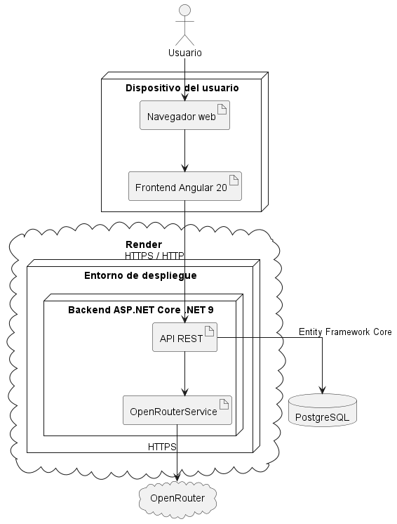

# Diagrama de Despliegue - Mentor-IA

## Arquitectura de despliegue

La arquitectura de despliegue de Mentor-IA representa la distribución de los elementos tecnológicos necesarios para ejecutar la plataforma y la comunicación entre ellos. La solución utiliza una arquitectura cliente-servidor, en la que el usuario accede desde un navegador web y el frontend se comunica con el backend mediante solicitudes HTTP.

### Frontend

El frontend está desarrollado con Angular 20 y proporciona la interfaz web mediante la cual los usuarios acceden a las funcionalidades de Mentor-IA. Se ejecuta en el navegador del usuario y se comunica con la API del backend para realizar las operaciones de la plataforma.

### Backend

El backend está desarrollado con ASP.NET Core sobre .NET 9 y se encarga de procesar las solicitudes recibidas desde el frontend, ejecutar la lógica de aplicación y gestionar el acceso a los datos.

Incluye la integración con OpenRouter mediante `OpenRouterService`. El proyecto dispone de configuración Docker para preparar su ejecución mediante contenedores y utiliza Render como plataforma de despliegue.

### Base de datos

La plataforma utiliza PostgreSQL para almacenar la información persistente de los usuarios, registros de progreso, sesiones de evaluación y flashcards.

El backend accede a la base de datos mediante Entity Framework Core y `PublicDbContext`.

### Servicios externos

Mentor-IA utiliza OpenRouter como servicio externo de inteligencia artificial. La comunicación se realiza desde el backend, que envía las solicitudes y procesa las respuestas recibidas.

Render se utiliza como plataforma de despliegue de la aplicación, mientras que Docker proporciona la configuración para la ejecución del backend mediante contenedores.

## Diagrama

