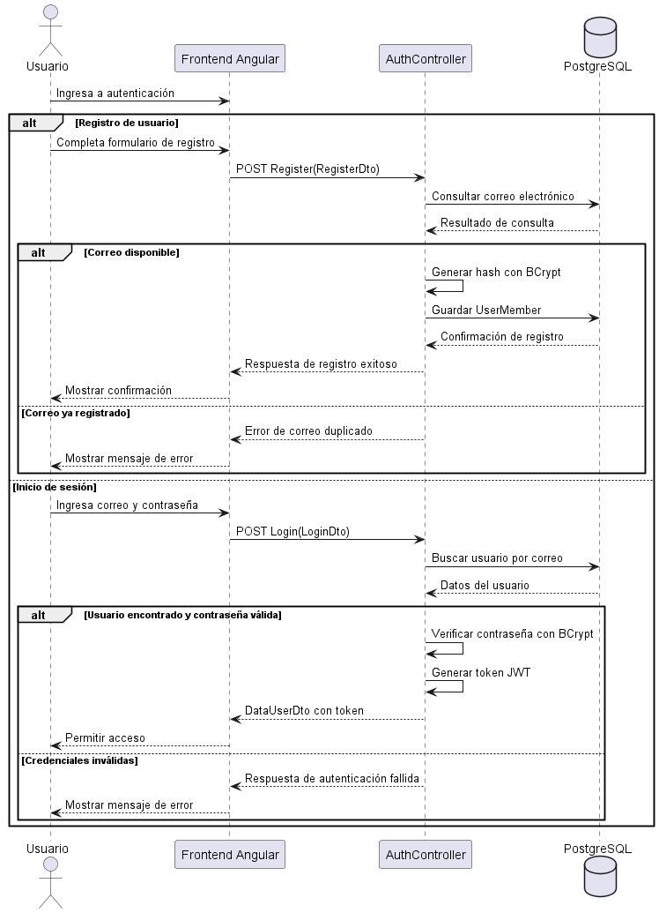
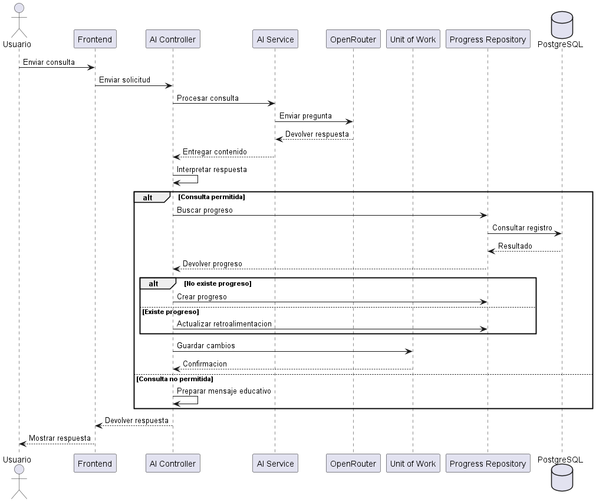
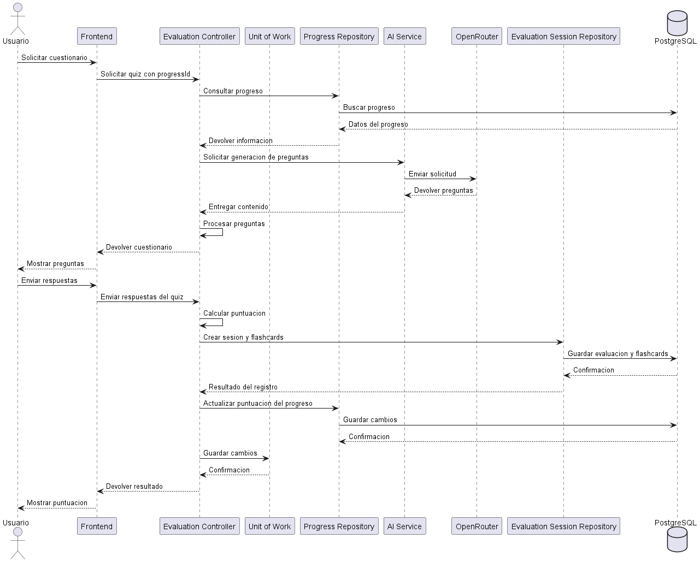

# Diagramas de Secuencia - Mentor-IA

## Secuencia 1 - Autenticación

### Descripción

El diagrama representa el proceso de autenticación de los usuarios en Mentor-IA, incluyendo el registro de una nueva cuenta y el inicio de sesión.

Durante el registro, el sistema recibe los datos del usuario, verifica que el correo electrónico no se encuentre registrado, genera el hash de la contraseña y almacena la información en la base de datos.

Para iniciar sesión, el usuario proporciona sus credenciales. El backend consulta la cuenta correspondiente, verifica la contraseña mediante BCrypt y, si los datos son correctos, genera un token JWT que permite acceder a las funcionalidades protegidas de la plataforma.

### Diagrama

## Secuencia 2 - Consulta al asistente IA

### Descripción

El diagrama representa el proceso de interacción entre el usuario y el asistente de inteligencia artificial de Mentor-IA.

El usuario escribe una consulta desde el frontend, que es enviada al backend mediante una solicitud HTTP. El controlador de inteligencia artificial procesa la petición y utiliza `OpenRouterService` para comunicarse con OpenRouter.

Una vez recibida la respuesta, el backend interpreta su contenido y determina si la consulta corresponde al ámbito educativo de la plataforma. Cuando la respuesta es válida y contiene un tema identificado, el sistema consulta el progreso del usuario y crea o actualiza el registro correspondiente. Finalmente, devuelve la respuesta al frontend para que sea presentada al usuario.

### Diagrama

## Secuencia 3 - Generación de Quiz

### Descripción

El diagrama representa el proceso de generación y realización de cuestionarios en Mentor-IA.

El usuario solicita un cuestionario asociado a un registro de progreso. El backend consulta la información correspondiente y utiliza `OpenRouterService` para solicitar la generación de las preguntas al servicio de inteligencia artificial.

Una vez recibidas y procesadas las preguntas, el sistema las devuelve al frontend para que el usuario pueda responderlas. Al enviar las respuestas, el backend calcula la puntuación, registra la sesión de evaluación y almacena las flashcards asociadas a las preguntas y respuestas correctas. También actualiza la puntuación general del progreso y devuelve el resultado de la evaluación.

### Diagrama

