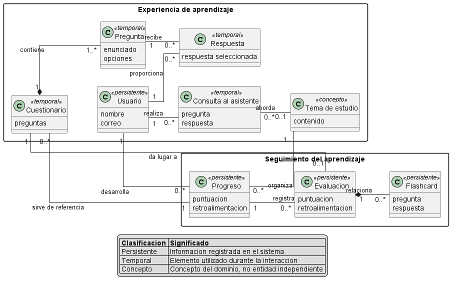

# Modelo de dominio - Mentor-IA

## 1. Introducción

El modelo de dominio de Mentor-IA representa los conceptos principales que intervienen en el proceso de aprendizaje asistido por inteligencia artificial y las relaciones que existen entre ellos.

Su propósito es describir cómo interactúan los usuarios con los temas de estudio, el asistente de inteligencia artificial, los cuestionarios, las evaluaciones y los recursos de aprendizaje. Esta representación permite comprender la lógica general de la solución desde una perspectiva funcional, sin limitarse a la estructura técnica del código o de la base de datos.

El modelo toma como referencia las historias de usuario, los casos de uso y las funcionalidades implementadas en la plataforma.

## 2. Conceptos principales del dominio

### 2.1 Usuario

Es la persona que utiliza Mentor-IA para resolver dudas, estudiar diferentes temas, realizar evaluaciones y consultar su progreso de aprendizaje.

El usuario cuenta con una sesión autenticada que le permite acceder a las funcionalidades privadas de la plataforma.

### 2.2 Tema de estudio

Representa el contenido o área de conocimiento sobre la cual el usuario realiza consultas y desarrolla actividades de aprendizaje.

Los temas permiten organizar la información del progreso y relacionar las actividades educativas con el contenido que está estudiando el usuario.

### 2.3 Consulta al asistente de inteligencia artificial

Representa la interacción mediante la cual el usuario plantea una pregunta relacionada con su aprendizaje y recibe una respuesta del asistente de inteligencia artificial.

La respuesta se procesa a través del backend y se presenta en la interfaz de conversación. Estas interacciones no se conservan como un historial consultable cuando el usuario inicia otra conversación.

### 2.4 Cuestionario

Representa una actividad de evaluación compuesta por preguntas relacionadas con un tema de estudio. Se genera mediante el servicio de inteligencia artificial y permite comprobar los conocimientos adquiridos.

### 2.5 Pregunta y respuesta

La pregunta corresponde a cada elemento que integra un cuestionario. La respuesta representa la opción o contestación proporcionada por el usuario durante la evaluación.

Estos conceptos participan en el desarrollo del cuestionario y en el procesamiento de las respuestas para determinar el resultado obtenido.

### 2.6 Evaluación

Representa el resultado del cuestionario una vez que el usuario envía sus respuestas. Incluye la puntuación y la retroalimentación correspondiente.

La información de la evaluación se registra dentro del proceso de aprendizaje y se relaciona con el progreso del tema correspondiente.

### 2.7 Progreso de aprendizaje

Representa el seguimiento del avance del usuario en un tema de estudio. Integra información como la puntuación y la retroalimentación asociadas a las actividades realizadas.

Permite consultar información sobre el avance del usuario y relacionarla con las evaluaciones desarrolladas.

### 2.8 Flashcards

Son recursos de estudio organizados mediante preguntas y respuestas que permiten repasar los contenidos relacionados con las actividades de evaluación.

En la implementación actual, las flashcards se encuentran asociadas a una sesión de evaluación y pueden consultarse desde el módulo correspondiente.

## 3. Relaciones entre los conceptos

Las relaciones principales del dominio describen cómo se desarrolla el proceso de aprendizaje:

- **Usuario y tema de estudio:** el usuario puede estudiar diferentes temas dentro de la plataforma.
- **Usuario y consulta:** el usuario puede realizar consultas al asistente de inteligencia artificial para resolver dudas relacionadas con su aprendizaje.
- **Tema y progreso:** el seguimiento del aprendizaje se organiza de acuerdo con los temas abordados por el usuario.
- **Progreso y cuestionarios:** el progreso de un tema sirve como referencia para generar cuestionarios relacionados con el contenido estudiado.
- **Cuestionario y preguntas:** cada cuestionario está compuesto por preguntas que el usuario debe responder.
- **Usuario y respuestas:** el usuario proporciona las respuestas durante el desarrollo del cuestionario.
- **Cuestionario y evaluación:** las respuestas enviadas se procesan para obtener el resultado de la evaluación.
- **Progreso y evaluación:** las evaluaciones realizadas se relacionan con el progreso del tema correspondiente.
- **Evaluación y flashcards:** las sesiones de evaluación mantienen asociadas las flashcards utilizadas como recursos de repaso.

## 4. Representación del modelo de dominio

El siguiente diagrama presenta los conceptos que participan en el proceso de aprendizaje de Mentor-IA y sus relaciones. También diferencia los elementos que representan información persistente de aquellos que intervienen temporalmente durante una interacción o evaluación.

## 5. Relación con la implementación del sistema

El modelo conceptual se refleja en la implementación mediante diferentes elementos del backend:

| Concepto del dominio | Representación en la implementación |
|---|---|
| Usuario | `UserMember` |
| Tema de estudio y progreso | `Progress` |
| Evaluación | `EvaluationSession` |
| Recursos de repaso | `Flashcard` |
| Consulta al asistente | `AIController` y `OpenRouterService` |
| Generación y procesamiento de cuestionarios | `EvaluationController` |

No todos los conceptos del modelo se almacenan como entidades independientes. Las consultas al asistente y los cuestionarios generados intervienen durante la ejecución de las funcionalidades, mientras que la información de progreso, las sesiones de evaluación y las flashcards cuenta con estructuras de persistencia.

La estructura técnica de las clases, sus atributos, herencia y relaciones se detalla en el diagrama de clases. Por su parte, el modelo entidad-relación representa la organización de los datos almacenados en PostgreSQL.

## 6. Conclusión

El modelo de dominio de Mentor-IA representa el proceso de aprendizaje desde la perspectiva del usuario y las actividades que desarrolla dentro de la plataforma. Sus conceptos permiten comprender la relación entre las consultas al asistente de inteligencia artificial, los temas de estudio, los cuestionarios, las evaluaciones, los recursos de repaso y el seguimiento del progreso.

Esta representación proporciona una visión funcional del sistema y sirve como referencia para comprender cómo las necesidades de aprendizaje se traducen en funcionalidades y posteriormente en elementos técnicos de la aplicación.