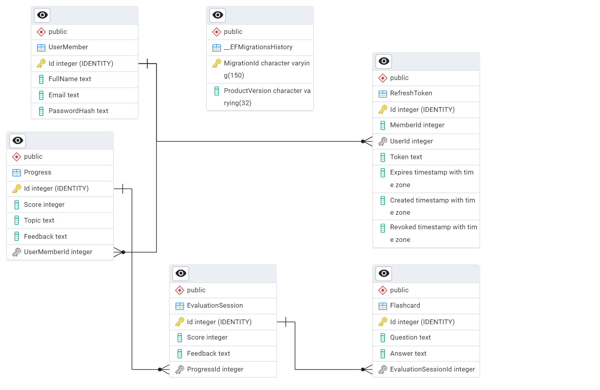

# Diagrama Entidad-Relación - Mentor-IA

## 1. Entidades

La base de datos de Mentor-IA está compuesta por entidades que permiten gestionar la información de los usuarios, realizar el seguimiento de su aprendizaje, registrar los resultados de las evaluaciones y almacenar los recursos de repaso.

Las principales entidades son:

- **UserMember:** almacena la información de los usuarios registrados en la plataforma, como su nombre, correo electrónico y contraseña cifrada mediante hash.
- **Progress:** registra el progreso de aprendizaje de cada usuario, incluyendo el tema estudiado, la puntuación y la retroalimentación obtenida.
- **EvaluationSession:** almacena los resultados de las evaluaciones, su puntuación y la retroalimentación correspondiente.
- **Flashcard:** almacena las preguntas y respuestas de los recursos de repaso asociados a una sesión de evaluación.
- **RefreshToken:** registra los tokens utilizados para gestionar la renovación de las sesiones de autenticación, junto con sus fechas de creación, expiración y revocación.

## 2. Relaciones

Las entidades se relacionan mediante claves primarias y foráneas, permitiendo mantener la integridad y asociación de la información almacenada:

- **UserMember - Progress:** un usuario puede tener varios registros de progreso, mientras que cada registro de progreso pertenece a un único usuario.
- **Progress - EvaluationSession:** un registro de progreso puede estar asociado a varias sesiones de evaluación, y cada sesión corresponde a un único registro de progreso.
- **EvaluationSession - Flashcard:** una sesión de evaluación puede tener varias flashcards asociadas, y cada flashcard pertenece a una única sesión.
- **UserMember - RefreshToken:** un usuario puede tener varios registros de tokens de renovación, y cada token pertenece a un único usuario.

## 3. Diagrama

El siguiente diagrama representa la estructura de la base de datos de Mentor-IA, mostrando las entidades, sus atributos, las claves primarias (PK), las claves foráneas (FK) y las relaciones existentes entre ellas.

