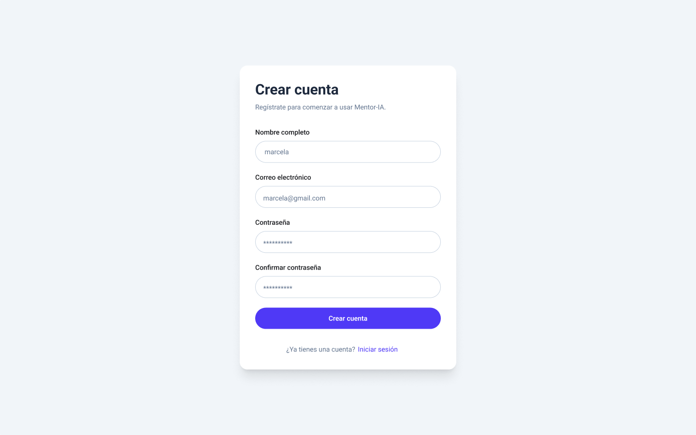

# Autenticación y Registro - Mentor-IA

## Login

### Descripción

El inicio de sesión permite que los usuarios registrados accedan a su cuenta en Mentor-IA mediante sus credenciales. Este proceso permite verificar la identidad del usuario y habilitar el acceso a las funcionalidades privadas de la plataforma.

La interfaz presenta un formulario para ingresar el correo electrónico y la contraseña. Una vez enviados los datos, el sistema realiza la solicitud de autenticación al backend y, cuando la respuesta indica que el usuario se encuentra autenticado, lo redirige al dashboard.

### Campos

| Campo | Tipo de entrada | Descripción |
|---|---|---|
| Correo electrónico | Email | Permite ingresar el correo electrónico asociado a la cuenta. |
| Contraseña | Password | Permite ingresar la contraseña de acceso. |

### Validaciones

| Campo | Validación | Mensaje |
|---|---|---|
| Correo electrónico | Obligatorio. | Campo obligatorio. |
| Correo electrónico | Formato de correo electrónico válido. | Formato de correo inválido. |
| Contraseña | Obligatoria. | Campo obligatorio. |
| Contraseña | Mínimo 6 caracteres. | Mínimo 6 caracteres. |

Las validaciones se ejecutan antes de enviar la solicitud de autenticación. Si el formulario contiene información inválida, los campos correspondientes se marcan para mostrar sus errores.

Cuando ocurre un error durante la autenticación, la interfaz presenta el mensaje proporcionado por el backend o, si no está disponible, el mensaje alternativo: «No fue posible iniciar sesión».

### Flujo

1. El usuario accede a la pantalla de inicio de sesión.
2. Ingresa su correo electrónico y contraseña.
3. Selecciona el botón de inicio de sesión.
4. El sistema valida los campos del formulario.
5. Si existen errores de validación, se muestran los mensajes correspondientes y se detiene el envío.
6. Si los datos cumplen las validaciones, se envía la solicitud de autenticación al backend.
7. Mientras se procesa la solicitud, se mantiene el estado de carga.
8. Si la autenticación es exitosa, se almacena la información de sesión y el usuario es redirigido al dashboard.
9. Si ocurre un error, se presenta el mensaje correspondiente.

### Sketch

## Registro

### Descripción

El registro permite crear una cuenta de usuario en Mentor-IA para acceder a las funcionalidades de aprendizaje de la plataforma.

El formulario solicita el nombre completo, el correo electrónico, la contraseña y su confirmación. Antes de enviar la información, el sistema comprueba que los campos obligatorios estén completos, que el correo tenga un formato válido, que la contraseña cumpla con la longitud mínima y que su confirmación coincida.

Cuando el registro se completa correctamente, el usuario es redirigido a la pantalla de inicio de sesión.

### Campos

| Campo | Tipo de entrada | Descripción |
|---|---|---|
| Nombre completo | Text | Permite ingresar el nombre del usuario. |
| Correo electrónico | Email | Permite ingresar la dirección de correo electrónico que se utilizará para el registro. |
| Contraseña | Password | Permite establecer la contraseña de la cuenta. |
| Confirmar contraseña | Password | Permite repetir la contraseña para comprobar que ambos valores coincidan. |

### Validaciones

| Campo | Validación | Mensaje |
|---|---|---|
| Nombre completo | Obligatorio. | El nombre es obligatorio. |
| Correo electrónico | Obligatorio. | El correo es obligatorio. |
| Correo electrónico | Formato de correo electrónico válido. | Ingresa un correo válido. |
| Contraseña | Obligatoria. | La contraseña es obligatoria. |
| Contraseña | Mínimo 6 caracteres. | Debe tener mínimo 6 caracteres. |
| Confirmar contraseña | Obligatorio. | Debes confirmar la contraseña. |
| Confirmar contraseña | Debe coincidir con la contraseña ingresada. | Las contraseñas no coinciden. |

La comprobación de coincidencia entre las contraseñas se realiza antes de enviar la solicitud al backend.

### Flujo

1. El usuario accede a la pantalla de registro.
2. Ingresa su nombre completo, correo electrónico, contraseña y confirmación de contraseña.
3. Selecciona el botón de creación de cuenta.
4. El sistema valida los campos del formulario.
5. Si existen errores de validación, se muestran los mensajes correspondientes y se detiene el envío.
6. El sistema comprueba que la contraseña y su confirmación coincidan.
7. Si los datos son válidos, se envía la solicitud de registro al backend.
8. Mientras se procesa la solicitud, el botón permanece deshabilitado y presenta el texto «Creando cuenta...».
9. Si el registro se completa correctamente, el usuario es redirigido a la pantalla de inicio de sesión.
10. Si ocurre un error durante el registro, se presenta el mensaje proporcionado por el backend o, si no está disponible, el mensaje alternativo «No fue posible registrar el usuario».

### Sketch

