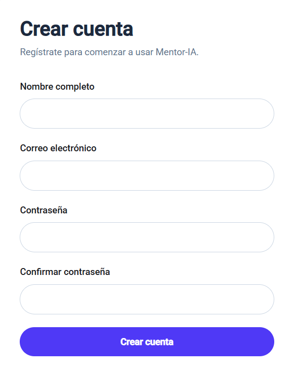

# Componentes UI - Mentor-IA

## Componentes comunes

Los componentes de interfaz de usuario (UI) permiten mantener una estructura visual consistente y facilitar la interacción con las diferentes funcionalidades de Mentor-IA. Su diseño sigue la identidad visual de la plataforma y busca conservar criterios comunes de distribución, tipografía, colores y comportamiento.

### Navbar

El componente de navegación permite acceder a las principales secciones de la plataforma.

Su diseño debe mantener una distribución organizada de las opciones, utilizar elementos visuales reconocibles y facilitar la identificación de la sección en la que se encuentra el usuario.

En dispositivos con espacio reducido, la distribución de los elementos debe adaptarse para conservar la facilidad de navegación.

### Button

Los botones permiten ejecutar acciones dentro de la plataforma, como enviar formularios, iniciar operaciones o acceder a funcionalidades.

Se utilizan para destacar las acciones disponibles y comunicar de manera clara qué ocurrirá al seleccionarlos.

Los criterios de diseño incluyen:
- Utilizar textos breves que describan la acción.
- Mantener colores y dimensiones coherentes con la identidad visual.
- Diferenciar las acciones principales de las secundarias.
- Proporcionar una apariencia visual que permita reconocer cuándo están disponibles o deshabilitados.

### Input

Los campos de entrada permiten al usuario ingresar información en formularios y otras funcionalidades de la plataforma.

Deben contar con una presentación clara que facilite identificar la información solicitada.

Sus criterios de diseño incluyen:
- Etiquetas que identifiquen cada campo.
- Espacios adecuados para ingresar información.
- Indicaciones comprensibles cuando se requiera orientar al usuario.
- Presentación visual de los errores de validación.
- Diferenciación entre campos habilitados y deshabilitados.

### Card

Las tarjetas permiten organizar y presentar información relacionada dentro de un espacio visual delimitado.

Se utilizan para agrupar contenidos y facilitar su consulta, manteniendo una separación clara entre los diferentes elementos de información.

Su diseño contempla:
- Espaciado interno adecuado.
- Jerarquía visual entre títulos y contenido.
- Bordes y fondos coherentes con la paleta de colores.
- Distribución organizada de la información.
- Adaptación a diferentes tamaños de pantalla.

### Loading

Los indicadores de carga permiten informar al usuario que una operación se encuentra en proceso.

Su finalidad es evitar la incertidumbre durante acciones que requieren tiempo de procesamiento.

Deben utilizarse de manera coherente con la operación que se está ejecutando y, cuando corresponda, acompañarse de un texto que explique el estado de la acción. En Mentor-IA se implementaron en los botones mientras una acción se encuentra en proceso.

### Footer

El pie de página permite presentar información complementaria al final de una interfaz.

Cuando forma parte de una pantalla, debe mantener una distribución ordenada y conservar la identidad visual de la plataforma. Su contenido debe limitarse a información pertinente para el contexto de la aplicación.

## Estados

Los componentes interactivos pueden presentar diferentes estados visuales según la disponibilidad del elemento y la interacción del usuario.

### Default

Representa la apariencia normal del componente cuando se encuentra disponible y no está siendo interactuado directamente.

Este estado establece la presentación visual inicial de botones, campos y demás elementos de la interfaz.

### Hover

Representa el cambio visual que puede presentar un elemento cuando el puntero del mouse se posiciona sobre él.

Permite comunicar que el elemento es interactivo y puede seleccionarse.

### Focus

Identifica visualmente el elemento que recibe el foco durante la navegación o interacción.

Debe permitir reconocer qué control está seleccionado, especialmente cuando se utiliza el teclado para desplazarse por la interfaz.

### Disabled

Representa un componente que temporalmente no está disponible para la interacción.

Su apariencia debe diferenciarse del estado normal para evitar que el usuario intente ejecutar una acción que no puede realizarse.

### Error

Identifica visualmente un componente que presenta un problema, especialmente en campos de formulario o durante el ingreso de información.

Debe acompañarse de un mensaje comprensible que explique la situación y, cuando corresponda, indique cómo corregirla.

## Sketches

En este apartado se incorporan las representaciones visuales de los componentes de Mentor-IA y sus diferentes estados.

- **Navbar:** estructura del menú de navegación.

- **Button:** botones principales y secundarios.

- **Input:** campos de formulario.

- **Card:** presentación de tarjetas de información.

- **Loading:** indicador de procesamiento.

