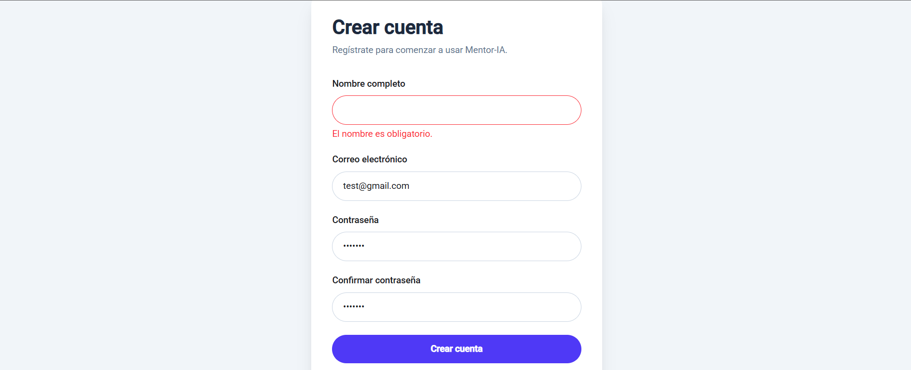
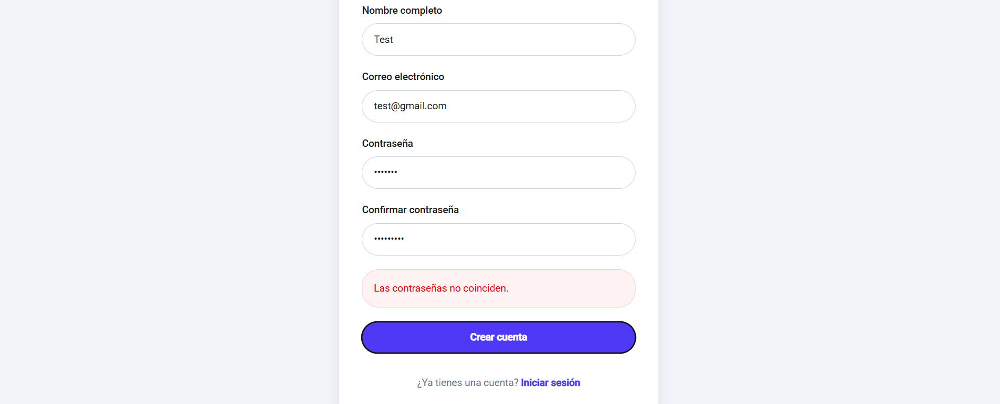
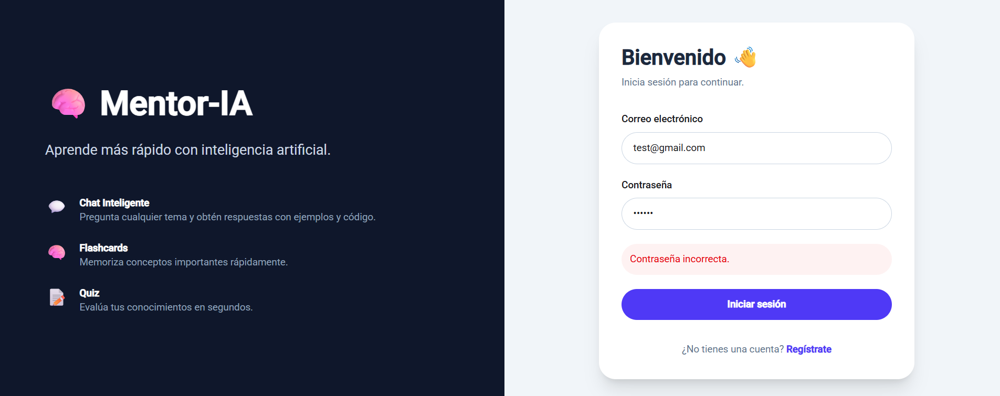
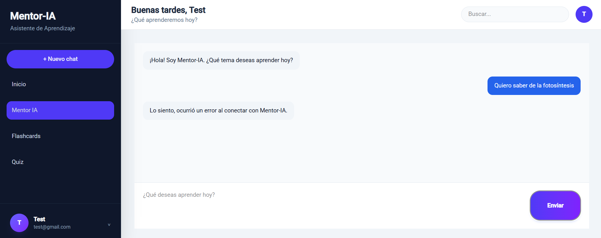

# Mensajes de Error - Mentor-IA

## Principios

Los mensajes de error de Mentor-IA siguen criterios de claridad, consistencia y facilidad de comprensión. Su finalidad es comunicar de manera sencilla las situaciones que afectan la interacción del usuario con la plataforma.

- **Claridad:** utilizar un lenguaje sencillo y directo, evitando términos técnicos que dificulten la comprensión.
- **Precisión:** cada mensaje debe corresponder a la situación que lo genera, evitando expresiones ambiguas.
- **Brevedad:** comunicar la información necesaria sin explicaciones excesivamente largas.
- **Consistencia:** mantener uniformidad en la redacción, el tono y la presentación visual de los mensajes.
- **Orientación al usuario:** cuando sea posible, indicar qué puede hacer el usuario para continuar.
- **Privacidad y seguridad:** evitar exponer contraseñas, tokens, trazas de ejecución o información interna de la infraestructura.
- **Presentación visual:** distinguir los errores del contenido habitual mediante recursos visuales, sin depender exclusivamente del color para comunicar su significado.

## Errores de autenticación

Los errores de autenticación corresponden a situaciones que pueden presentarse durante el inicio de sesión y el registro de usuarios.

**Inicio de sesión**

Cuando no es posible completar el inicio de sesión y el servidor no proporciona un mensaje específico, se presenta el siguiente texto:

| Situación | Mensaje |
|---|---|
| Error durante el inicio de sesión sin mensaje específico del servidor. | No fue posible iniciar sesión. |

Cuando el servidor proporciona un mensaje de error, la aplicación utiliza dicha respuesta para informar al usuario.

**Registro de usuarios**

Cuando no es posible completar el registro y el servidor no proporciona un mensaje específico, se presenta el siguiente texto:

| Situación | Mensaje |
|---|---|
| Error durante el registro sin mensaje específico del servidor. | No fue posible registrar el usuario. |

La aplicación contempla la lectura de los mensajes enviados por el backend mediante las propiedades `message` y `Message`.

**Control de acceso**

Las rutas protegidas requieren que el usuario esté autenticado. Cuando un usuario no autenticado intenta acceder a una de estas secciones, la aplicación lo redirige a la pantalla de inicio de sesión.

## Errores de formularios

Los formularios de Mentor-IA incorporan validaciones para evitar el envío de información obligatoria incompleta o con formatos no válidos. Los mensajes se presentan junto al campo correspondiente para facilitar la identificación y corrección de los datos.

**Formulario de inicio de sesión**

| Campo | Condición | Validación |
|---|---|---|
| Correo electrónico | Campo obligatorio. | `Validators.required` |
| Correo electrónico | Debe tener un formato de correo válido. | `Validators.email` |
| Contraseña | Campo obligatorio. | `Validators.required` |
| Contraseña | Debe contener al menos 6 caracteres. | `Validators.minLength(6)` |

**Formulario de registro**

| Campo | Condición | Mensaje |
|---|---|---|
| Nombre completo | Campo obligatorio. | El nombre es obligatorio. |
| Correo electrónico | Campo obligatorio. | El correo es obligatorio. |
| Correo electrónico | Debe tener un formato válido. | Ingresa un correo válido. |
| Contraseña | Campo obligatorio. | La contraseña es obligatoria. |
| Contraseña | Debe contener al menos 6 caracteres. | Debe tener mínimo 6 caracteres. |
| Confirmación de contraseña | Campo obligatorio. | Debes confirmar la contraseña. |
| Confirmación de contraseña | Debe coincidir con la contraseña ingresada. | Las contraseñas no coinciden. |

La coincidencia entre la contraseña y su confirmación se comprueba antes de enviar la solicitud de registro.

**Presentación de los errores**

Los mensajes de validación se muestran asociados al campo que presenta el inconveniente. La interfaz utiliza un borde rojo para identificar los campos con errores y un texto de ayuda debajo del campo para explicar la condición que debe corregirse.

Los errores generales durante el envío del formulario de registro se presentan en un contenedor con fondo rojo claro, borde rojo y texto rojo.

**Estado de procesamiento**

Durante el envío del formulario de registro, el botón cambia su texto para indicar que la operación se encuentra en curso:

| Estado | Texto del botón |
|---|---|
| Estado normal | Crear cuenta |
| Procesando solicitud | Creando cuenta... |

El botón permanece deshabilitado mientras se procesa la solicitud.

## Errores de API

La comunicación entre el frontend y el backend de Mentor-IA se realiza mediante solicitudes HTTP a los servicios de la aplicación. Estas operaciones incluyen autenticación, gestión del chat, progreso, evaluaciones y tarjetas de estudio.

Cuando una operación genera un error, la información de respuesta del servicio se utiliza como referencia para comunicar el resultado al usuario.

Los mensajes relacionados con las solicitudes al backend deben cumplir los siguientes criterios:

- Comunicar el resultado de la operación de manera comprensible.
- Mantener una redacción coherente con el resto de la plataforma.
- Evitar mostrar información interna del servidor.
- No presentar detalles técnicos de excepciones o trazas de ejecución.
- Diferenciar los mensajes dirigidos al usuario de la información utilizada para el diagnóstico técnico.

Los detalles necesarios para identificar y analizar errores de comunicación deben gestionarse mediante los mecanismos de registro y diagnóstico del backend.

## Errores del servicio IA

Mentor-IA utiliza un servicio de inteligencia artificial para generar respuestas educativas a partir de las preguntas realizadas por los usuarios. El backend incorpora mecanismos para interpretar las respuestas generadas, comprobar su estructura y controlar que el contenido corresponda al propósito educativo de la plataforma.

**Solicitudes no educativas**

El servicio de inteligencia artificial determina si la solicitud corresponde a una intención educativa mediante la propiedad `allow` de la respuesta JSON.

Cuando el valor de esta propiedad es `false`, el backend devuelve el siguiente mensaje:

> Lo siento, no puedo dar respuesta a este tema. Solo temas educativos son válidos.

Este comportamiento permite mantener el propósito de Mentor-IA como plataforma de acompañamiento educativo.

**Respuestas que no pueden procesarse**

El servicio solicita que la inteligencia artificial entregue sus respuestas mediante una estructura JSON con las siguientes propiedades:

| Propiedad | Descripción |
|---|---|
| `allow` | Indica si la solicitud puede ser atendida. |
| `topic` | Identifica el tema principal de la solicitud. |
| `answer` | Contiene la respuesta generada. |

El backend intenta extraer e interpretar el contenido JSON recibido. Si no consigue procesar la respuesta mediante los mecanismos establecidos, presenta el siguiente mensaje:

> Lo siento, no puedo procesar esa petición en este momento.

**Respuestas educativas válidas**

Cuando la solicitud es aceptada y la respuesta puede procesarse correctamente, el backend entrega el contenido generado por la inteligencia artificial. La respuesta puede incluir el nombre del usuario, la pregunta realizada, el tema identificado, la explicación generada y el identificador del progreso asociado cuando corresponde.

**Registro de eventos**

El controlador del servicio de inteligencia artificial utiliza mecanismos de registro para facilitar el seguimiento y diagnóstico de su funcionamiento. Se registran eventos relacionados con la recepción de respuestas, la interpretación de la estructura JSON y las respuestas que no pueden procesarse.

## Mensajes de conexión

La comunicación entre el frontend y el backend requiere que los servicios de la aplicación estén disponibles para procesar las solicitudes. Cuando se presentan inconvenientes de comunicación, estos pueden afectar operaciones como el inicio de sesión, el registro, el envío de preguntas al mentor y la consulta de información de aprendizaje.

Los mensajes relacionados con estas situaciones deben ser claros, breves y orientados a informar sobre la imposibilidad de completar una operación. También deben evitar mostrar direcciones internas, detalles de infraestructura o información técnica de los servicios.

## Sketches

Los siguientes esquemas representan la ubicación y presentación de los mensajes de error dentro de los formularios y las interacciones principales de Mentor-IA.

**Error de validación en el formulario de registro**

Representa la presentación de un mensaje cuando un campo obligatorio no contiene información.

**Error de coincidencia de contraseñas**

Representa el mensaje presentado cuando la contraseña ingresada y su confirmación son diferentes.

**Error de contraseña incorrecta durante el inicio de sesión**

Representa el mensaje cuando la contraseña ingresada no coincide con el correo del usuario que se intenta registrar.

**Error de procesamiento de la inteligencia artificial**

Representa la respuesta alternativa del backend cuando no es posible procesar correctamente el contenido recibido del servicio de inteligencia artificial.

