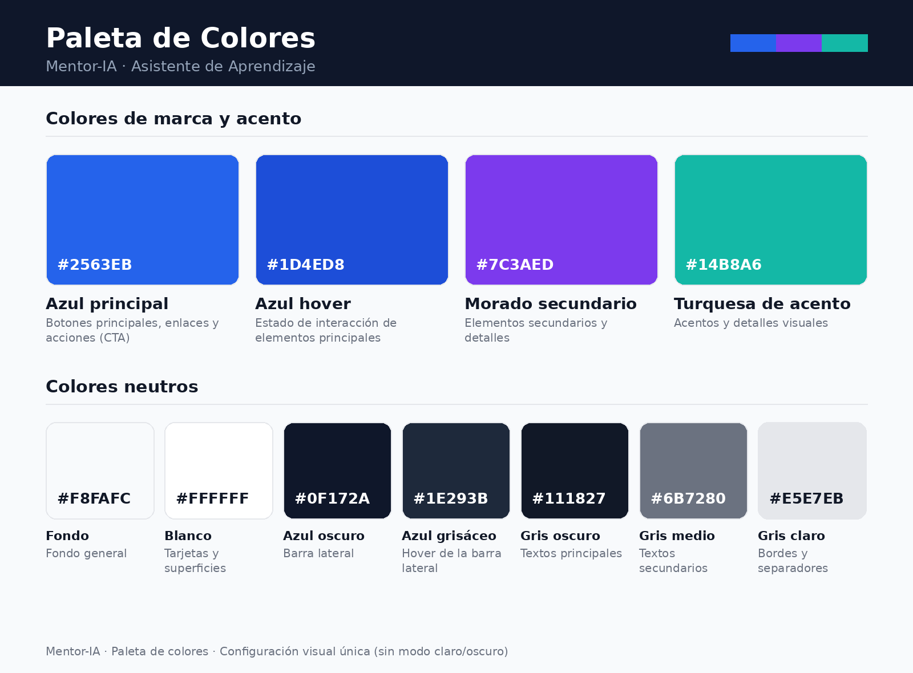

# Paleta de Colores - Mentor-IA

## 1. Paleta principal

La identidad visual de Mentor-IA utiliza una combinación de colores azules, morados y turquesas, complementados con tonos neutros. La selección busca transmitir confianza, creatividad, innovación y claridad, cualidades asociadas con una plataforma de aprendizaje apoyada por inteligencia artificial.

| Color | Código | Uso | Justificación |
|---|---|---|---|
| Azul principal | #2563EB | Botones principales, enlaces y acciones destacadas. | El azul suele asociarse con confianza, seguridad y estabilidad. Su uso permite destacar las acciones principales y transmitir fiabilidad al usuario. |
| Azul hover | #1D4ED8 | Estado de interacción de los elementos principales. | Mantiene la identidad del azul principal y refuerza visualmente la interacción mediante un tono más profundo. |
| Morado secundario | #7C3AED | Elementos secundarios y detalles de la interfaz. | Se relaciona con creatividad, imaginación e innovación, cualidades que complementan el enfoque tecnológico de Mentor-IA. |
| Turquesa de acento | #14B8A6 | Elementos de acento y detalles visuales. | Se asocia con equilibrio, frescura y tranquilidad. Complementa la paleta y aporta una sensación visual ligera. |
| Fondo | #F8FAFC | Fondo general de la aplicación. | Los tonos claros transmiten limpieza, amplitud y sencillez, favoreciendo una experiencia visual ordenada. |
| Blanco | #FFFFFF | Tarjetas y superficies de contenido. | Se relaciona con claridad y simplicidad. Permite separar los espacios de contenido y facilita la lectura. |
| Azul oscuro | #0F172A | Barra lateral de navegación. | Transmite formalidad, estabilidad y profundidad. Además, genera contraste con el contenido principal. |
| Azul grisáceo | #1E293B | Estado hover de los elementos de la barra lateral. | Conserva la apariencia sobria del menú y permite diferenciar los elementos durante la interacción. |
| Gris oscuro | #111827 | Textos principales. | Aporta neutralidad y contraste, facilitando la lectura de la información. |
| Gris medio | #6B7280 | Textos secundarios. | Mantiene una apariencia discreta y permite establecer jerarquías entre la información principal y complementaria. |
| Gris claro | #E5E7EB | Bordes y separadores. | Se relaciona con neutralidad y equilibrio visual. Permite delimitar componentes sin recargar la interfaz. |

## 2. Colores de llamada a la acción (CTA)

Los elementos de llamada a la acción (CTA) utilizan principalmente el azul #2563EB para destacar botones y acciones importantes dentro de la plataforma. Este color se asocia con confianza y seguridad, por lo que resulta apropiado para orientar al usuario durante sus actividades de aprendizaje.

Cuando el usuario interactúa con estos elementos, el color cambia a #1D4ED8, proporcionando una respuesta visual mediante un tono más profundo.

El morado #7C3AED y el turquesa #14B8A6 complementan la identidad visual y pueden utilizarse para destacar elementos secundarios y detalles de la interfaz.

## 3. Aplicación de la paleta

Los colores se encuentran definidos mediante variables CSS globales en el archivo de estilos principal de la aplicación. Esto permite mantener una identidad visual consistente y reutilizar los mismos valores en los diferentes componentes de Mentor-IA.

La plataforma utiliza una única configuración visual y no cuenta con modos independientes de visualización claro y oscuro.